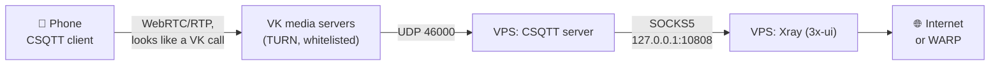

# 🚀 xui-bootstrap

[](https://github.com/JINXPIL/xui-bootstrap/actions/workflows/ci.yaml)
[](#)
[](https://github.com/MHSanaei/3x-ui)
[](https://github.com/XTLS/Xray-core)
[](LICENSE)

One-command deployment of the **3x-ui** panel on a fresh VPS (**Ubuntu 22.04/24.04**, **Debian 11/12**) — with protocols that work right after install, a trusted SSL certificate, DDoS protection and smart routing.

One command, and the server gets:

* **VLESS-XHTTP-Reality + Hysteria2 on port 443** (TCP and UDP) — a modern pair with zero Xray warnings; gRPC, Vision, Trojan, Shadowsocks-2022, TUIC and WS are opt-in;
* firewall ports that **open by themselves** for any inbound you create in the panel;
* a trusted **Let's Encrypt** certificate even without a domain (IP certificate), renewed **without dropping clients**;
* **anti-DDoS** on nftables, fail2ban, SSH key login;
* **WARP for Gemini/Google AI** with health checks, **AliExpress direct**, server-side blocking of RU traffic;
* **auto-updates**: OS security patches, geodata and (optionally) the Xray core — tested against the live config, with rollback.

> 🇷🇺 Русская версия: [README.md](README.md)

---

## 💡 Why

3x-ui **does not open firewall ports itself**. You spin up Hysteria2 or TUIC in the panel, and the client times out because UFW is closed. That's the classic "only VLESS XHTTP/gRPC/WS work, everything else drops".

`xui-bootstrap` fixes this at the root: the **`xui-fw-sync`** daemon reads the panel's inbound list via API every 2 minutes and opens exactly the ports needed (TCP or UDP, by protocol and transport), closing the ports of deleted inbounds. Add a protocol in the panel — it just works. Rules you added to UFW by hand are left alone: the daemon only manages its own (commented `xui-sync`).

---

## ✨ Features

### 🔐 Protocols: XHTTP + Hysteria2 by default

Each protocol is provisioned with fresh keys on its own port. The default `AUTO_INBOUNDS` set is the pair Xray 26.x considers current and the one that survives Russian DPI (TSPU) best:

| Protocol | Name in `AUTO_INBOUNDS` | Port | Default | Xray 26.x status |
| :--- | :--- | :---: | :---: | :--- |
| VLESS Reality XHTTP | `xhttp-reality` | 443/tcp | ✅ | recommended |
| Hysteria2 | `hysteria2` | 443/udp | ✅ | current (QUIC) |
| VLESS Reality gRPC | `grpc-reality` | 2087/tcp | — | deprecated (replaced by XHTTP), still works |
| VLESS Reality Vision | `reality-vision` | 8443/tcp | — | works; TSPU cuts long TCP sessions more often than QUIC |
| Trojan Reality | `trojan-reality` | 2083/tcp | — | deprecated |
| Shadowsocks-2022 | `ss2022` | 2095/tcp+udp | — | deprecated |
| TUIC v5 | `tuic` | 2097/udp | — | panel sidecar, not Xray |
| VLESS WebSocket + TLS | `ws-tls` | 8444/tcp | — | deprecated; needs a trusted cert (LE on the IP or a domain) |

XHTTP (TCP 443) and Hysteria2 (UDP 443) share port 443: from the outside it looks like ordinary HTTPS and QUIC, and Xray prints no warnings at all.

"Deprecated" in Xray means *non-removal deprecated*: the protocol works but may be removed in a future release. Once removed, a core with such an inbound simply won't start, so a new core is first tested against the live config (`xui-update check`, see [auto-updates](#-auto-updates-os-geodata-and-optional-xray-core)). Any protocol outside the default set is enabled by adding its name to `AUTO_INBOUNDS`, for example:

```bash
AUTO_INBOUNDS="xhttp-reality hysteria2 grpc-reality"
```

**Re-running is safe.** `bootstrap.sh` asks the panel for existing inbounds and skips the ones already there (by client email or remark): keys and ports stay the same, and "Duplicate email" no longer kills the install.

Keys (UUID, x25519, shortId, passwords, SS keys) are generated by the **local `xray` binary**, not the panel API, so the format always matches the core version. Hysteria2 gets the trusted Let's Encrypt certificate (or a self-signed one with a **SHA-256 pin** if LE is unavailable).

### 🔐 Trusted SSL (Let's Encrypt)

Clients (FlClash, Happ) reject self-signed certificates. With `SSL_MODE=letsencrypt` (the default) the script issues a valid certificate via **acme.sh**: a regular 90-day one when `DOMAIN` is set, or an IP certificate otherwise (`shortlived` profile, ~6.7 days). It is installed on the panel, the subscription and the QUIC inbounds.

**Renewal without dropping clients.** The `xui-acme-renew` timer runs daily. The IP certificate is renewed on day ~3 (leaving room for several failed attempts; ≈2–3 issuances per week against the LE limit of 5), a domain certificate about once a month. After renewal:

* the panel gets `SIGHUP` and re-reads the certificate;
* **xray is not restarted** — TLS inbounds re-read the file every hour on their own;
* the panel database is not touched.

Re-running `bootstrap.sh` does not re-issue a valid certificate (no wasted LE quota). If issuance fails (port 80 busy, rate limit), it falls back to self-signed.

**If renewal fails anyway.** An IP certificate lives less than a week, so `bash selfcheck.sh` flags in red a certificate with less than 48 hours left and shows the renewal errors. In that case `bash update-tools.sh` forces a renewal (opening port 80 first) and, if it fails, prints the reason from the acme.sh log. The renewal timer also opens port 80 before every attempt, in case the rule was deleted.

### 🌐 Smart routing: Gemini and AliExpress

* **Gemini / Google AI → WARP.** Google blocks datacenter IPs, so Gemini "loaded forever". The script registers **WARP** directly with Cloudflare (no panel API), builds a native wireguard outbound with `reserved` bytes and writes it into `xrayTemplateConfig` via SQLite. The rule is global (not tied to a `user`), `routing.domainStrategy = IPIfNonMatch`.
* **Health checks that don't hurt.** The `xui-warp` timer checks the path every 6 hours in two stages on a temporary local xray (host routing is untouched): first the tunnel itself (`1.1.1.1/cdn-cgi/trace` → `warp=on`), then Google — with retries and waiting for the port to be ready. Then, depending on the result:
  * tunnel up, Google answers → does nothing;
  * tunnel won't come up → tries endpoint UDP ports (2408 → 500 → 4500 → 1701); if none works, it **does not restart the panel** (a new IP wouldn't help);
  * tunnel up but Google blocks → registers candidates, tests each one and swaps WARP **only for a verified working one**.

  x-ui is restarted only on a real improvement, because every restart drops all clients. Detailed diagnostics: `xui-warp diag`.
* **Fallback via the official client.** If `warp-svc` (Cloudflare WARP, MASQUE protocol) runs on the server in proxy mode, `xui-warp use-svc` moves Gemini onto it, and `xui-warp use-wg` moves it back.
* **AliExpress → VPS direct.** `aliexpress.ru` used to fall under `BLOCK_RU` and get blackholed. Now it has its own direct rule.
* **`BLOCK_RU`** drops `geoip:ru` and `.ru/.su/.рф` server-side.

Rules are idempotent: re-runs never duplicate them or break your manual rules.

### 🛡️ DDoS protection

A dedicated **nftables `xui_ddos`** table (priority −150, evaluated before UFW): protection against SYN floods, junk TCP flags (NULL/XMAS) and ICMP floods, plus `sysctl` hardening.

* The IP of the current SSH admin is allow-listed (nft + fail2ban).
* Brute-force protection is a **soft rate limit on SSH only, with no whole-IP ban**: accidentally hitting a closed port from a browser no longer kills your session.
* Proxy traffic, including Hysteria2 UDP, is not volume-limited.

### 🔄 Auto-updates: OS, geodata and (optional) Xray core

* **OS security patches** — `unattended-upgrades` installs `*-security` only and cleans up unused packages and old kernels (`AUTO_UPDATES=1`).
* **Geodata (geoip/geosite)** — the `xui-geodata` timer refreshes the lists weekly through the panel's own API. Fresh RU and bypass lists mean fewer routing misses ("works, then doesn't"). Safe and **on by default** (`AUTO_UPDATE_GEODATA=1`): the core and inbounds are untouched.
* **Xray core** — the `xui-core` timer, weekly:
  1. takes the latest **stable** release — the one GitHub marks "Latest"; if it is older than the installed core, it skips (downgrade protection);
  2. **tests it against the live panel config** (`xray run -test` — binds no ports, doesn't disturb the running xray);
  3. installs it only if the config loads, then watches the start-up and rolls back on failure.

  **Off by default** (`AUTO_UPDATE_CORE=0`), on purpose: the automatic check catches a core that won't start, but **not** a silent Reality regression, where the core starts and some clients quietly fail to connect. Turn it on when you're ready to check connectivity after an update.

All of this is one script, **`xui-update`** (`geodata` / `check` / `core` / `all`), which you can also run by hand. `xui-update check` tests the **newest** Xray tag, pre-releases included, without installing anything — so you see in advance whether your config will survive the next release.

### 🎭 Masking

* **Reality** — donor auto-validation (TLS 1.3 + H2 via cURL) and comparison of the donor's and the VPS's ASN.
* **Self-steal** — your own domain, an Nginx decoy site and a Let's Encrypt certificate.

### 🔒 Secure by default

* **UFW**: the panel is closed to the internet, access goes through an SSH tunnel.
* **fail2ban** for SSH (`aggressive` mode, progressive ban 1 h → 2 h → … up to a week) and for the panel (reads the 3x-ui 3.9 log format from the journal).
* **Key-only login** (`SSH_KEYS_ONLY=1`): password off, root by key only, `MaxAuthTries 3`. The result is verified with `sshd -T`, and the cloud `50-cloud-init.conf` can't override it. If `authorized_keys` has no keys, the script will **not** disable the password, so you can't lock yourself out. Step by step — see [SSH key login](#-ssh-key-login).
* **A separate panel API token per script** (`xui-bootstrap`, `xui-fw-sync`, `xui-update`, `xui-selfcheck` — listed under "Settings → API tokens"). In 3x-ui ≥ 3.9, `-getApiToken` re-issues a token by name and revokes the previous one, so a shared token would break the other scripts on the fly.

> TUIC is off by default: it runs through the `tuic-server` sidecar and is unstable on some VPSes, while Hysteria2 already covers QUIC. Enable it by adding `tuic` to `AUTO_INBOUNDS`.

---

## ⚡ Quick start

You need a fresh Ubuntu/Debian VPS, root access and free ports 80 (certificate issuance) and 443 (TCP and UDP).

**Option A — right on the server** (works from anywhere, including PowerShell on Windows):

```bash
ssh root@SERVER_IP
apt-get update && apt-get install -y git
git clone https://github.com/JINXPIL/xui-bootstrap.git && cd xui-bootstrap
cp config.example.env config.env && nano config.env   # at minimum: REALITY_SNI
bash bootstrap.sh
```

**Option B — one command from your machine** (Linux, macOS or WSL/Git Bash on Windows):

```bash
git clone https://github.com/JINXPIL/xui-bootstrap.git && cd xui-bootstrap
cp config.example.env config.env && nano config.env
./deploy.sh root@SERVER_IP
```

`deploy.sh` also copies your SSH key to the server (`ssh-copy-id`) and saves the report locally to `servers/IP.txt`.

When it finishes, the terminal and `/root/xui-result.txt` (mode `600`) contain the panel login and password, the SSH-tunnel command and ready `vless://` / `hysteria2://` / `tuic://` links for clients.

### Updating a deployed server

Daemons, checks, SSL renewal, fail2ban — no reinstall. Inbounds, keys and WARP are untouched, and x-ui is not restarted:

```bash
cd xui-bootstrap && git pull && bash update-tools.sh
```

If `git pull` complains about local changes, discard them: `git fetch origin && git reset --hard origin/main`. Your `config.env` survives — it's in `.gitignore`.

---

## 🔑 SSH key login

Bots brute-force the root password around the clock. A key is safer, and `SSH_KEYS_ONLY=1` turns password login off entirely.

**Steps 1–3 run on your own computer, not on the server.** The prompt should be `PS C:\Users\...>` (Windows) or your local terminal, not `root@server`.

**Windows (PowerShell):**

```powershell
# 1. create a key (press Enter at every question)
ssh-keygen -t ed25519
# 2. send the public part to the server (asks for the root password one last time)
type $env:USERPROFILE\.ssh\id_ed25519.pub | ssh root@IP "mkdir -p ~/.ssh && chmod 700 ~/.ssh && cat >> ~/.ssh/authorized_keys && chmod 600 ~/.ssh/authorized_keys"
# 3. check that login works with the key alone
ssh -o PasswordAuthentication=no root@IP "echo key works"
```

**Linux / macOS:**

```bash
ssh-keygen -t ed25519
ssh-copy-id root@IP
ssh -o PasswordAuthentication=no root@IP "echo key works"
```

**4. Only after you see "key works"** — on the server:

```bash
passwd                                        # change the root password while you're at it
cd xui-bootstrap && SSH_KEYS_ONLY=1 bash update-tools.sh
```

**5. Check** from your computer — the server must refuse without asking for a password:

```bash
ssh -o PubkeyAuthentication=no root@IP        # → Permission denied (publickey)
```

> ⚠️ Keep your current SSH session open until you've confirmed key login in a new window. Never share the private key (`id_ed25519` — the file **without** `.pub`) and keep a backup: without it, the only way in is the hosting provider's console.

---

## ⚙️ Key `config.env` options

| Variable | Default | Description |
| :--- | :---: | :--- |
| `MASK_MODE` | `reality` | `reality` or `selfsteal` |
| `REALITY_SNI` | `vk.com` | Donor domain (TLS 1.3 + H2) |
| `DOMAIN` | — | Your domain: required for selfsteal and for a 90-day LE certificate (otherwise LE on the IP) |
| `ACME_EMAIL` | — | Email for Let's Encrypt |
| `SSL_MODE` | `letsencrypt` | `letsencrypt` (trusted) or `self-signed` |
| `AUTO_INBOUNDS` | `xhttp-reality hysteria2` | Protocols to provision (existing ones are skipped) |
| `BLOCK_RU` | `1` | Drop RU traffic server-side |
| `ENABLE_WARP` | `1` | WARP for Gemini/Google AI + health checks |
| `ENABLE_DDOS` | `1` | nftables anti-DDoS |
| `ENABLE_BBR` | `1` | TCP BBR + fq |
| `AUTO_UPDATES` | `1` | OS security auto-updates |
| `AUTO_UPDATE_GEODATA` | `1` | Weekly geoip/geosite refresh |
| `AUTO_UPDATE_CORE` | `0` | Weekly Xray core update (with test and rollback) |
| `SSH_KEYS_ONLY` | `0` | `1` — key-only SSH login |
| `PANEL_PUBLIC` | `0` | `0` — panel via SSH tunnel only, `1` — open to the internet |
| `PANEL_SSL` | `1` | HTTPS for the panel (`0` — HTTP, tunnel only) |
| `EXTRA_TCP_PORTS` / `EXTRA_UDP_PORTS` | — | Extra UFW ports, space-separated |

Full list with comments: [`config.example.env`](config.example.env).

---

## 🔐 Panel access

By default the panel listens on `127.0.0.1` only and is invisible from outside. Go in through an SSH tunnel (the command also works in PowerShell):

```bash
ssh -N -L 2222:127.0.0.1:<PANEL_PORT> root@<IP>
# then in the browser: http://127.0.0.1:2222/<webBasePath>/
```

`bash selfcheck.sh` prints the exact link (port, path, http or https) in its "Панель" (Panel) section. Keep the tunnel window open while you work in the panel.

---

## 🔧 Management (on the server)

```bash
# Whole-server diagnostics in one command (changes nothing)
bash selfcheck.sh

# Manual updates
xui-update geodata              # refresh geoip/geosite now
xui-update check                # will the newest Xray (incl. pre-releases) accept the current config?
xui-update check v26.10.10      # …or any specific tag
xui-update core                 # update the core: test → install → watch → roll back

# Update the scripts on a running server (x-ui is not restarted)
bash update-tools.sh
bash update-tools.sh --fix-ocsp # + silence "ignoring invalid OCSP" (one x-ui restart)

# Core auto-update without reinstalling
systemctl enable --now xui-core.timer     # on
systemctl disable --now xui-core.timer    # off

# What fires when, and the logs
systemctl list-timers 'xui-*'
journalctl -u xui-geodata -u xui-core -n 50 --no-pager
journalctl -u xui-warp -n 30 --no-pager
journalctl -u xui-acme-renew -n 30 --no-pager

# WARP (Gemini/Google AI)
xui-warp diag                   # tunnel, ports, warp-svc, DNS — changes nothing
xui-warp rotate                 # change the WARP IP (the candidate is tested first)
xui-warp use-svc 40000          # route Gemini through warp-svc (official client, proxy mode)
xui-warp use-wg                 # back to the built-in WireGuard
```

The scripts' own output is in Russian.

---

## 📱 Happ subscription routing (3x-ui 3.9)

xui-bootstrap **does not fill** this field. If you paste an https link into "Settings → Subscription → Happ → Routing", the panel fetches it every 5 minutes and checks the limits:

* response body — at most **16 KB**;
* the resulting `happ://routing/onadd/<base64>` link — at most **8 KB**, i.e. compact JSON ≲ 6 KB.

Anything bigger is rejected silently; the log only says "no validated value is cached". `bash selfcheck.sh` shows the real sizes. Happ needs compact rules: references to `geosite:`/`geoip:` instead of embedded domain lists.

---

## 🩺 Common problems

| Symptom | Cause and fix |
| :--- | :--- |
| Clients report "expired certificate"; Hysteria2, TUIC, WS and subscription updates fail | The Let's Encrypt IP certificate expired — the scheduled renewal didn't work. `bash update-tools.sh` forces a renewal and, if it fails, shows why (most often port 80 is closed). Reality protocols don't depend on this certificate. |
| Gemini stopped working after an Xray update | In 26.10.17 (a pre-release) the WireGuard outbound that WARP runs on moved to a new network stack. Check `xui-warp diag`; if the tunnel won't come up, switch back to 26.10.10 in the panel — the version 3x-ui 3.10.2 ships with. |
| Re-running `bootstrap.sh` failed with "Duplicate email" | Fixed: existing inbounds are skipped. Update the scripts. |
| x-ui restarts every 6 hours, WARP log shows "000000" | The old `xui-warp` wrongly counted the check as failed (its temporary config had no `.json` extension, so Xray couldn't load it) and rotated the IP with a restart. Fixed: `git pull && bash update-tools.sh`. |
| "ignoring invalid OCSP" warning | Old TLS inbounds with `ocspStapling ≠ 0`: `bash update-tools.sh --fix-ocsp`. |
| selfcheck: "REALITY не на 443" (REALITY not on 443) | A warning, not an error: the inbound works, but a non-standard port is more visible to DPI. |
| Happ: "no validated value is cached" | The routing-rules link exceeds the limit — see [Happ routing](#-happ-subscription-routing-3x-ui-39). |
| Panel stopped opening by IP | `PANEL_PUBLIC=0` (the default) puts the panel behind an SSH tunnel — that's expected, see [panel access](#-panel-access). |
| `SSH_KEYS_ONLY=1`, but password login still works | No key in `authorized_keys` — the script won't disable the password and lock you out. Add a key first. |
| Gemini doesn't work through CSQTT | Most often sniffing is off on the `10808` SOCKS inbound — see [the Gemini section](#-if-gemini-doesnt-work-through-csqtt). |
| The client shows latency, but sites don't open | The FlClash ping only tests the handshake. Download something large through the profile to test real traffic. |

---

## 🌍 Bypassing "whitelists": the CSQTT → Xray cascade

In "whitelist" mode the carrier only lets traffic through to approved Russian addresses. A direct connection to a foreign VPS doesn't get through at all, no matter the masking (Reality, Hysteria2, Shadowsocks).

The working bypass is to hide proxy traffic inside a **legitimate media stream** that is on the whitelist. CSQTT disguises traffic as a VK (VKontakte) audio call: the client hands it to VK's media servers, which relay the packets to your VPS. There, Xray from 3x-ui takes over and sends it to the internet — directly or through WARP.



> ℹ️ `bootstrap.sh` does **not** install this cascade — it's a manual setup on top of a ready server. A curated list of whitelist client tools (csqtt, olcrtc, vk-turn-proxy) and ready profiles lives in [flclash-converter](https://github.com/JINXPIL/flclash-converter). The CSQTT interface is in Russian, so its labels are quoted as-is with a translation.

### Step 1. Prepare the VPS

**Build dependencies:**

```bash
apt update && apt install -y curl git build-essential pkg-config libssl-dev cmake clang
```

**Swap file.** Building the crypto libraries (`aws-lc-sys`) and linking with LTO need up to 2 GB of memory; on a VPS with 1–2 GB RAM and no swap the build dies from OOM (`exit 101`). If `swapon --show` prints nothing, create swap:

```bash
fallocate -l 2G /swapfile && chmod 600 /swapfile
mkswap /swapfile && swapon /swapfile
echo '/swapfile none swap sw 0 0' >> /etc/fstab
```

**Packet forwarding** — the CSQTT server needs it for its TUN interface:

```bash
sysctl -w net.ipv4.ip_forward=1
echo 'net.ipv4.ip_forward = 1' > /etc/sysctl.d/99-csqtt.conf
```

### Step 2. Local SOCKS5 in 3x-ui

CSQTT passes the decrypted traffic to Xray through it.

1. Open the panel through the [SSH tunnel](#-panel-access).
2. **Inbounds → Add inbound:**
   * **Protocol:** `mixed` (SOCKS5 + HTTP; `socks` in older panel versions);
   * **Port:** `10808`;
   * **Listen IP:** `127.0.0.1` — strictly local, otherwise you get an open proxy for the whole internet;
   * **Authentication:** off;
   * **UDP:** on;
   * **Sniffing:** on — `HTTP`, `TLS`, `QUIC`, plus **Route Only** (same as the inbounds the script creates). Without it Gemini won't work — see [below](#-if-gemini-doesnt-work-through-csqtt) for why.
3. Save and check that the port listens locally only:

   ```bash
   ss -tlpn | grep 10808
   # LISTEN ... 127.0.0.1:10808 ... users:(("xray-linux-amd64",pid=...))
   ```

### Step 3. Build CSQTT from source

```bash
# Rust toolchain
curl --proto '=https' --tlsv1.2 -sSf https://sh.rustup.rs | sh -s -- -y
source "$HOME/.cargo/env"

# sources (take the repository link from the CSQTT project page)
git clone <CSQTT_REPOSITORY_URL> /opt/csqtt
cd /opt/csqtt/rust-server
cargo build --release --target x86_64-unknown-linux-gnu   # tens of minutes on a small VPS

# install and clean up (frees 3–4 GB)
install -m 755 target/x86_64-unknown-linux-gnu/release/csqtt /usr/local/bin/csqtt
install -d -m 700 /etc/csqtt
cargo clean
```

### Step 4. systemd service and firewall

Don't put passwords straight into the unit file: any user on the server can read files in `/etc/systemd/system/`. Generate them and keep them in a separate file with mode `600`:

```bash
( umask 077; cat > /etc/csqtt/csqtt.env <<EOF
CSQTT_WEB_PASS=$(openssl rand -base64 18)
CSQTT_SECRET=$(openssl rand -base64 24)
EOF
)
cat /etc/csqtt/csqtt.env    # save the web-panel password and the secret in a password manager
```

```bash
cat > /etc/systemd/system/csqtt.service <<'EOF'
[Unit]
Description=CSQTT media tunnel server
After=network-online.target x-ui.service
Wants=network-online.target

[Service]
Type=simple
EnvironmentFile=/etc/csqtt/csqtt.env
WorkingDirectory=/etc/csqtt
ExecStart=/usr/local/bin/csqtt \
  --listen 0.0.0.0:46000 \
  --web-port 46002 \
  --config-dir /etc/csqtt \
  --web-user admin \
  --web-pass ${CSQTT_WEB_PASS} \
  --password ${CSQTT_SECRET}
Restart=always
RestartSec=3
LimitNOFILE=65535

[Install]
WantedBy=multi-user.target
EOF

systemctl daemon-reload
systemctl enable --now csqtt
```

**Firewall.** Only the media port is opened to the outside. Keep the CSQTT web panel closed, like the 3x-ui panel, and reach it through a tunnel. `xui-fw-sync` won't touch a rule with your own comment:

```bash
ufw allow 46000/udp comment 'csqtt'
```

**Check:**

```bash
systemctl status csqtt --no-pager
ss -ulpn | grep 46000    # UDP — media traffic
ss -tlpn | grep 46002    # TCP — web panel
```

### Step 5. CSQTT web panel

On your computer, open a tunnel and go to `https://127.0.0.1:46002` (login `admin`, password — `CSQTT_WEB_PASS` from `/etc/csqtt/csqtt.env`; the browser may warn about a self-signed certificate):

```bash
ssh -N -L 46002:127.0.0.1:46002 root@SERVER_IP
```

**Link to Xray (the «Настройки» / Settings tab):**

1. In **«DNS адреса»** (DNS addresses) pick `Cloudflare DNS` (or `Google DNS`) and press **«Применить DNS»** (Apply DNS).
2. In the **«Локальный прокси SOCKS5 UDP»** (Local SOCKS5 UDP proxy) block press **`+`**: name `Xray SOCKS`, port `10808`, login and password empty → **«Создать»** (Create).
3. The log (`journalctl -u csqtt -f`) should show:

   ```text
   [INFO] Connecting SOCKS5 forwarder to local SOCKS5 127.0.0.1:10808...
   [INFO] Local SOCKS5 route 127.0.0.1:10808 is active (TCP and UDP)
   ```

**Client profile (the «Клиенты» / Clients tab → «Создать доступ» / Create access):**

* **Client name** — e.g. `Phone`;
* **Validity (days)** — `0` (no expiry);
* **Peer port** — strictly **`46000`** (not the internal `10808`);
* **«Добавить VK хеши»** (Add VK hashes) — off: the client refreshes hashes itself;
* turn on **«Создать ссылку csqtt://»** (Create a csqtt:// link) → **«Создать»** (Create).

Open the client card and copy the `csqtt://…` link or save the QR code. The link contains an access secret — share it only with yourself.

### Step 6. CSQTT client on Android

1. **Import:** paste the `csqtt://` link or scan the QR code — the server address and key fill in automatically.
2. **«Туннель» (Tunnel) tab:** hash mode `Авто` (Auto), transport `UDP`, masking `Средняя` (Medium).
3. **Masking hashes:** at the bottom of the tab tap **«🔑 Авторизация нужна»** (Authorization required) and sign in to VK — preferably with a separate spare account. Once the **«VK хеши»** (VK hashes) counter reads `6/6`, you can connect.

### 📋 App whitelist or blacklist

The mode is chosen on the **«Исключ»** (Exclusions) tab.

**Whitelist — only the checked apps go through the tunnel.** Check the apps that should work through the VPS (YouTube, Telegram, a browser, etc.) — those apps work through the tunnel. Everything else goes directly over the mobile network and, under the carrier's whitelist, opens only if the service itself is on that list (banks, Gosuslugi, VK).

* System apps appear in the list after the **«Системные приложения»** (System apps) toggle.
* If a Google app (YouTube, Gemini) is checked but won't load or won't sign in, also check **Google Play Services** (`com.google.android.gms`): sign-in and some requests go through it.
* Reconnect the tunnel after changing the list.

**Blacklist — everything goes through the tunnel except the checked apps.** Leave «Выбрано: 0» (Selected: 0), and all Android traffic goes into the tunnel, including system DNS and Google background services. Check only the apps that need a direct exit over the mobile network (banks, Gosuslugi, Avito).

### 🤖 If Gemini doesn't work through CSQTT

WARP itself is checked on the server with `xui-warp diag`: if it reports the tunnel is alive and Google answers, WARP isn't the problem. Then check two things.

1. **Phone.** In the whitelist, both the Gemini app (or the browser you open gemini.google.com in) and **Google Play Services** are checked. Without them, Google account sign-in bypasses the tunnel and the carrier blocks it.
2. **Server — sniffing on the `10808` SOCKS inbound** ([step 2](#step-2-local-socks5-in-3x-ui)). CSQTT works as a VPN on the phone and hands connections to Xray by IP address, while the "Gemini → WARP" rule matches by domain. Without sniffing, Xray can't tell it's Gemini and sends the request directly — from a datacenter IP that Google blocks. Turn sniffing on (`HTTP`, `TLS`, `QUIC`, Route Only), save the inbound and reconnect the client.

The same domain rules handle AliExpress-direct and `BLOCK_RU`, so without sniffing those don't work either.

---

## 📁 Layout

```text
xui-bootstrap/
├── bootstrap.sh                 # orchestrator
├── deploy.sh                    # one-command delivery to a VPS
├── update-tools.sh              # update the daemons on a deployed server
├── selfcheck.sh                 # server diagnostics (read-only)
├── config.example.env           # configuration
├── lib/                         # modules: preflight, system, security, mask, ssl, xui, keys,
│                                #   inbounds, routing, warp, firewall, autoupdate, updates
├── bin/
│   ├── xui-fw-sync              # syncs the firewall with the panel's inbounds
│   ├── xui-warp                 # WARP checks, port/IP selection, diag, use-svc
│   └── xui-update               # geodata and Xray core (test, install, rollback)
├── clients/mihomo.example.yaml  # FlClash/Clash Verge client config (XHTTP + Hysteria2)
├── inbounds/*.json.example      # inbound templates for every protocol
├── systemd/                     # unit + timer for xui-fw-sync and xui-warp
├── nftables/                    # anti-DDoS table template
├── tests/                       # validate.sh + behavioral tests
└── .github/workflows/ci.yaml    # GitHub Actions
```

The other timers (`xui-geodata`, `xui-core`, `xui-acme-renew`) are created on the server by the scripts.

---

## 🧪 Development

```bash
bash tests/validate.sh                                # all offline: templates, routing, nft, WARP, SSL,
                                                      # idempotency, Xray release selection
XRAY_BIN=/path/to/xray bash tests/xray_test.sh        # templates against the real core (xray run -test)
MIHOMO_BIN=/path/to/mihomo bash tests/mihomo_test.sh  # client template against real Mihomo (-t)
```

The behavioral tests run the real logic against strict stubs:

* an "xray" that, like the real one, refuses a config without the `.json` extension;
* SIGHUP under `/bin/sh` with a child "xray" that must survive a certificate renewal;
* re-running `bootstrap.sh` on a copy of a real server's state;
* picking the Xray release when GitHub "Latest" is older than the installed core.

**CI (GitHub Actions):** shellcheck, shfmt and all tests on every push and PR, plus **weekly** — the templates against fresh Xray releases (and the pinned 26.9.30) and Mihomo. If Xray removes a feature the templates use, CI turns red before a server breaks.

> ⚠️ Uploading through the GitHub web UI skips hidden folders (`.github/`). Create files there with **Add file → Create new file**, typing the full path. And upload new files before the ones that reference them, or the intermediate commit turns red.

---

## 🛡️ Security

* `config.env` and `inbounds/*.json` are in `.gitignore`, so keys never reach the repository.
* The report and exports are stored on the VPS with mode `600`.
* Don't post the root password, subscription links, `csqtt://` links or the contents of `/root/xui-result.txt` in issues or chats. If any of it leaks, change the password (`passwd`) and re-issue the clients in the panel.

## 📄 License

[MIT](LICENSE).
