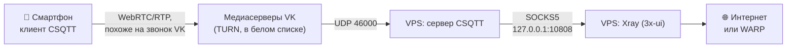

# 🚀 xui-bootstrap

[](https://github.com/JINXPIL/xui-bootstrap/actions/workflows/ci.yaml)
[](#)
[](https://github.com/MHSanaei/3x-ui)
[](https://github.com/XTLS/Xray-core)
[](LICENSE)

Автоматическое развёртывание панели **3x-ui** на чистом VPS (**Ubuntu 22.04/24.04**, **Debian 11/12**) — с протоколами, которые работают сразу после установки, доверенным SSL, защитой от DDoS и умной маршрутизацией.

Одна команда — и на сервере:

* **VLESS-XHTTP-Reality + Hysteria2 на порту 443** (TCP и UDP) — современная связка без единого предупреждения Xray; gRPC, Vision, Trojan, Shadowsocks-2022, TUIC и WS включаются по желанию;
* порты в фаерволе **открываются сами** под любые инбаунды, созданные в панели;
* доверенный **Let's Encrypt** даже без домена (сертификат на IP) с продлением **без обрыва клиентов**;
* **анти-DDoS** на nftables, fail2ban, вход по SSH-ключу;
* **WARP для Gemini/Google AI** с проверкой здоровья, **AliExpress напрямую**, блокировка RU-трафика на сервере;
* **автообновления**: security-патчи ОС, geodata и (по желанию) ядро Xray — с проверкой на живом конфиге и откатом.

> 🇬🇧 English version: [README.en.md](README.en.md)

---

## 💡 Почему это нужно

3x-ui **не открывает порты в фаерволе сам**. Поднимаешь в панели Hysteria2 или TUIC — а клиент уходит в таймаут, потому что UFW закрыт. Отсюда классическое «работают только VLESS XHTTP/gRPC/WS, остальное отваливается».

`xui-bootstrap` чинит это на корню: демон **`xui-fw-sync`** каждые 2 минуты читает список инбаундов через API панели и открывает ровно нужные порты (TCP или UDP — по протоколу и транспорту), а порты удалённых инбаундов закрывает. Добавил протокол в панели — он заработал сам. Правила, которые ты добавил в UFW вручную, демон не трогает: он управляет только своими (с комментарием `xui-sync`).

---

## ✨ Что внутри

### 🔐 Протоколы: XHTTP + Hysteria2 по умолчанию

Каждый протокол поднимается со свежими ключами на своём порту. Дефолтный набор `AUTO_INBOUNDS` — связка, которую Xray 26.x считает современной и которая лучше всего переживает ТСПУ:

| Протокол | Имя в `AUTO_INBOUNDS` | Порт | По умолчанию | Статус в Xray 26.x |
| :--- | :--- | :---: | :---: | :--- |
| VLESS Reality XHTTP | `xhttp-reality` | 443/tcp | ✅ | рекомендуемый |
| Hysteria2 | `hysteria2` | 443/udp | ✅ | актуальный (QUIC) |
| VLESS Reality gRPC | `grpc-reality` | 2087/tcp | — | устаревший (замена — XHTTP), пока работает |
| VLESS Reality Vision | `reality-vision` | 8443/tcp | — | работает; длинные TCP-сессии ТСПУ режет чаще, чем QUIC |
| Trojan Reality | `trojan-reality` | 2083/tcp | — | устаревший |
| Shadowsocks-2022 | `ss2022` | 2095/tcp+udp | — | устаревший |
| TUIC v5 | `tuic` | 2097/udp | — | сайдкар панели, не Xray |
| VLESS WS-TLS *(selfsteal)* | `ws-tls` | 8444/tcp | — | устаревший |

XHTTP (TCP 443) и Hysteria2 (UDP 443) делят порт 443 — снаружи это выглядит как обычный HTTPS и QUIC, а Xray не выдаёт ни одного предупреждения.

«Устаревший» у Xray — пометка *non-removal deprecated*: протокол работает, но может быть удалён в будущем релизе. После удаления ядро с таким инбаундом просто не стартует, поэтому новое ядро сначала проверяется на живом конфиге (`xui-update check`, см. [автообновления](#-автообновления-ос-geodata-и-опц-ядро-xray)). Любой протокол не из дефолта включается добавлением имени в `AUTO_INBOUNDS`, например:

```bash
AUTO_INBOUNDS="xhttp-reality hysteria2 grpc-reality"
```

**Повторный запуск безопасен.** `bootstrap.sh` спрашивает у панели существующие инбаунды и пропускает те, что уже есть (по email клиента или названию): ключи и порты не меняются, ошибка «Duplicate email» больше не роняет установку.

Ключи (UUID, x25519, shortId, пароли, SS-ключи) генерирует **локальный бинарник `xray`**, а не API панели, — поэтому формат гарантированно совпадает с версией ядра. Hysteria2 получает доверенный сертификат Let's Encrypt (или самоподписанный с **SHA-256 pin**, если LE недоступен).

### 🔐 Доверенный SSL (Let's Encrypt)

Клиенты (FlClash, Happ) отвергают самоподписанные сертификаты. При `SSL_MODE=letsencrypt` (по умолчанию) скрипт через **acme.sh** выпускает валидный сертификат: при заданном `DOMAIN` — обычный 90-дневный, без домена — на IP (профиль `shortlived`, ~6,7 суток). Сертификат ставится на панель, подписку и QUIC-инбаунды.

**Продление без обрыва клиентов.** Таймер `xui-acme-renew` срабатывает раз в сутки. IP-сертификат продлевается на ~3-и сутки (с запасом на несколько неудачных попыток; ≈2–3 выпуска в неделю при лимите LE 5), доменный — раз в ~месяц. После продления:

* панель получает `SIGHUP` и перечитывает сертификат;
* **xray не перезапускается** — TLS-инбаунды сами перечитывают файл раз в час;
* база панели не трогается.

Повторный `bootstrap.sh` не перевыпускает действующий сертификат (не тратит лимиты LE). Если выпуск не удался (занят порт 80, rate-limit) — откат на самоподписанный.

### 🌐 Умная маршрутизация: Gemini и AliExpress

* **Gemini / Google AI → WARP.** Google блокирует IP дата-центров, поэтому Gemini «вечно грузился». Скрипт регистрирует **WARP** напрямую в Cloudflare (без API панели), строит нативный wireguard-outbound с `reserved`-байтами и записывает его в `xrayTemplateConfig` через SQLite. Правило глобальное (без привязки к `user`), `routing.domainStrategy = IPIfNonMatch`.
* **Проверка здоровья без самовредительства.** Таймер `xui-warp` раз в 6 часов проверяет путь в две стадии на временном локальном xray (маршрутизация хоста не трогается): сначала сам туннель (`1.1.1.1/cdn-cgi/trace` → `warp=on`), потом Google — с ретраями и ожиданием готовности порта. Дальше по ситуации:
  * туннель жив, Google отвечает → ничего не делает;
  * туннель не поднимается → подбирает UDP-порт эндпоинта (2408 → 500 → 4500 → 1701); если не работает ни один — **панель не перезапускает** (смена IP тут не поможет);
  * туннель жив, но Google блокирует → регистрирует кандидатов, проверяет каждого и подменяет WARP **только проверенно рабочим**.

  x-ui перезапускается лишь при реальном улучшении: каждый рестарт рвёт подключения всех клиентов. Подробная диагностика — `xui-warp diag`.
* **Запасной выход через официальный клиент.** Если на сервере стоит `warp-svc` (Cloudflare WARP, протокол MASQUE) в proxy-режиме, `xui-warp use-svc` переводит Gemini на него, `xui-warp use-wg` — обратно.
* **AliExpress → прямой выход VPS.** `aliexpress.ru` раньше попадал под `BLOCK_RU` и уходил в blackhole. Теперь для него отдельное правило — напрямую.
* **`BLOCK_RU`** режет `geoip:ru` и `.ru/.su/.рф` на стороне сервера.

Правила идемпотентны: повторный запуск не плодит дубли и не ломает твои ручные правила.

### 🛡️ Защита от DDoS

Отдельная таблица **nftables `xui_ddos`** (priority −150, срабатывает раньше UFW): защита от SYN-флуда, мусорных TCP-флагов (NULL/XMAS) и ICMP-флуда, плюс харденинг `sysctl`.

* IP текущего SSH-администратора попадает в белый список (nft + fail2ban).
* Защита от перебора — **мягкий rate-limit только на SSH, без бана всего IP**: случайный заход браузером на неслушающий порт больше не рвёт твою сессию.
* Прокси-трафик, включая UDP Hysteria2, по объёму не режется.

### 🔄 Автообновления: ОС, geodata и (опц.) ядро Xray

* **Security-патчи ОС** — `unattended-upgrades` ставит только `*-security`, чистит неиспользуемые пакеты и старые ядра (`AUTO_UPDATES=1`).
* **Geodata (geoip/geosite)** — таймер `xui-geodata` раз в неделю обновляет списки через штатный API панели. Свежие списки РФ и обходных доменов — меньше промахов маршрутизации («то работает, то нет»). Безопасно и **включено по умолчанию** (`AUTO_UPDATE_GEODATA=1`): ядро и инбаунды не трогаются.
* **Ядро Xray** — таймер `xui-core` раз в неделю:
  1. берёт последний **стабильный** релиз — тот, что GitHub отмечает «Latest»; если он старее установленного — пропускает (защита от даунгрейда);
  2. **проверяет его на живом конфиге панели** (`xray run -test` — порты не занимает, работающий xray не мешает);
  3. ставит, только если конфиг загружается, затем контролирует запуск и при сбое откатывается.

  **Выключено по умолчанию** (`AUTO_UPDATE_CORE=0`), и это осознанно: автопроверка ловит падение ядра, но **не** ловит тихую регрессию Reality, когда ядро стартует, а часть клиентов молча не подключается. Включай, когда готов проверить подключение после апдейта.

Всем этим управляет один скрипт **`xui-update`** (`geodata` / `check` / `core` / `all`), его же можно запускать вручную. `xui-update check` проверяет без установки **самый новый** тег Xray, включая пре-релизы, — так видно заранее, переживёт ли твой конфиг следующий релиз.

### 🎭 Маскировка

* **Reality** — с автопроверкой донора (TLS 1.3 + H2 через cURL) и сравнением ASN донора и VPS.
* **Self-steal** — свой домен, сайт-заглушка в Nginx и сертификат Let's Encrypt.

### 🔒 Безопасность из коробки

* **UFW**: панель закрыта снаружи, доступ — через SSH-туннель.
* **fail2ban** для SSH (режим `aggressive`, прогрессивный бан 1 ч → 2 ч → … до недели) и для панели (читает формат логов 3x-ui 3.9 из журнала).
* **Вход только по ключу** (`SSH_KEYS_ONLY=1`): пароль выключен, root — только по ключу, `MaxAuthTries 3`. Результат проверяется через `sshd -T`, облачный `50-cloud-init.conf` его не перебивает. Если в `authorized_keys` нет ни одного ключа, скрипт пароль **не** отключит — чтобы ты не потерял доступ. Пошагово — в разделе [Вход по SSH-ключу](#-вход-по-ssh-ключу).
* **Отдельный API-токен у каждого скрипта** (`xui-bootstrap`, `xui-fw-sync`, `xui-update`, `xui-selfcheck` — видны в «Настройки → API-токены»). В 3x-ui ≥ 3.9 `-getApiToken` перевыпускает токен по имени и отзывает прежний, так что общий токен ломал бы соседние скрипты на лету.

> TUIC по умолчанию выключен: он работает через сайдкар `tuic-server` и нестабилен на части VPS, а QUIC и так закрывает Hysteria2. Включается добавлением `tuic` в `AUTO_INBOUNDS`.

---

## ⚡ Быстрый старт

Нужен чистый VPS с Ubuntu/Debian, доступ root и свободные порты 80 (выпуск сертификата) и 443 (TCP и UDP).

**Вариант A — прямо на сервере** (работает откуда угодно, в том числе из PowerShell в Windows):

```bash
ssh root@IP_СЕРВЕРА
apt-get update && apt-get install -y git
git clone https://github.com/JINXPIL/xui-bootstrap.git && cd xui-bootstrap
cp config.example.env config.env && nano config.env   # минимум — REALITY_SNI
bash bootstrap.sh
```

**Вариант B — с локальной машины одной командой** (Linux, macOS или WSL/Git Bash в Windows):

```bash
git clone https://github.com/JINXPIL/xui-bootstrap.git && cd xui-bootstrap
cp config.example.env config.env && nano config.env
./deploy.sh root@IP_СЕРВЕРА
```

`deploy.sh` заодно копирует на сервер твой SSH-ключ (`ssh-copy-id`), а отчёт сохраняет локально в `servers/IP.txt`.

По завершении в терминале и в `/root/xui-result.txt` (права `600`): логин и пароль панели, команда SSH-туннеля и готовые ссылки `vless://` / `hysteria2://` / `tuic://` для клиентов.

### Обновить уже развёрнутый сервер

Демоны, проверки, продление SSL, fail2ban — без переустановки. Инбаунды, ключи и WARP не трогаются, x-ui не перезапускается:

```bash
cd xui-bootstrap && git pull && bash update-tools.sh
```

Если `git pull` ругается на локальные изменения, сбрось их: `git fetch origin && git reset --hard origin/main`. Твой `config.env` при этом сохранится — он в `.gitignore`.

---

## 🔑 Вход по SSH-ключу

Пароль root боты перебирают круглосуточно. Ключ надёжнее, а `SSH_KEYS_ONLY=1` выключает вход по паролю совсем.

**Шаги 1–3 выполняются на своём компьютере, а не на сервере.** Приглашение должно быть `PS C:\Users\...>` (Windows) или твой локальный терминал, а не `root@server`.

**Windows (PowerShell):**

```powershell
# 1. создать ключ (на все вопросы — Enter)
ssh-keygen -t ed25519
# 2. отправить публичную часть на сервер (последний раз спросит пароль root)
type $env:USERPROFILE\.ssh\id_ed25519.pub | ssh root@IP "mkdir -p ~/.ssh && chmod 700 ~/.ssh && cat >> ~/.ssh/authorized_keys && chmod 600 ~/.ssh/authorized_keys"
# 3. проверить вход именно по ключу
ssh -o PasswordAuthentication=no root@IP "echo ключ работает"
```

**Linux / macOS:**

```bash
ssh-keygen -t ed25519
ssh-copy-id root@IP
ssh -o PasswordAuthentication=no root@IP "echo ключ работает"
```

**4. Только когда увидел «ключ работает»** — на сервере:

```bash
passwd                                        # заодно смени пароль root
cd xui-bootstrap && SSH_KEYS_ONLY=1 bash update-tools.sh
```

**5. Проверка** с компьютера — сервер должен отказать без вопроса о пароле:

```bash
ssh -o PubkeyAuthentication=no root@IP        # → Permission denied (publickey)
```

> ⚠️ Не закрывай текущую SSH-сессию, пока не убедился в новом окне, что вход по ключу работает. Приватный ключ (`id_ed25519` — файл **без** `.pub`) никому не отправляй и сохрани его копию: без него на сервер можно попасть только через консоль хостинга.

---

## ⚙️ Основные параметры `config.env`

| Переменная | По умолчанию | Описание |
| :--- | :---: | :--- |
| `MASK_MODE` | `reality` | `reality` или `selfsteal` |
| `REALITY_SNI` | `vk.com` | Домен-донор (TLS 1.3 + H2) |
| `DOMAIN` | — | Свой домен: нужен для selfsteal и для 90-дневного LE (без него — LE на IP) |
| `ACME_EMAIL` | — | Email для Let's Encrypt |
| `SSL_MODE` | `letsencrypt` | `letsencrypt` (доверенный) или `self-signed` |
| `AUTO_INBOUNDS` | `xhttp-reality hysteria2` | Какие протоколы поднять (существующие пропускаются) |
| `BLOCK_RU` | `1` | Резать RU-трафик на сервере |
| `ENABLE_WARP` | `1` | WARP для Gemini/Google AI + проверка здоровья |
| `ENABLE_DDOS` | `1` | Анти-DDoS на nftables |
| `ENABLE_BBR` | `1` | TCP BBR + fq |
| `AUTO_UPDATES` | `1` | Security-автообновления ОС |
| `AUTO_UPDATE_GEODATA` | `1` | Еженедельное обновление geoip/geosite |
| `AUTO_UPDATE_CORE` | `0` | Еженедельное обновление ядра Xray (с проверкой и откатом) |
| `SSH_KEYS_ONLY` | `0` | `1` — только вход по ключу |
| `PANEL_PUBLIC` | `0` | `0` — панель только через SSH-туннель, `1` — открыть в интернет |
| `PANEL_SSL` | `1` | HTTPS панели (`0` — HTTP, только за туннелем) |
| `EXTRA_TCP_PORTS` / `EXTRA_UDP_PORTS` | — | Доп. порты для UFW через пробел |

Полный список с комментариями — в [`config.example.env`](config.example.env).

---

## 🔐 Доступ к панели

По умолчанию панель слушает только `127.0.0.1` — снаружи её не видно. Заходи через SSH-туннель (команда работает и в PowerShell):

```bash
ssh -N -L 2222:127.0.0.1:<ПОРТ_ПАНЕЛИ> root@<IP>
# затем в браузере: http://127.0.0.1:2222/<webBasePath>/
```

Точную ссылку (порт, путь, http или https) показывает `bash selfcheck.sh` в разделе «Панель». Окно с туннелем держи открытым, пока работаешь в панели.

---

## 🔧 Управление (на сервере)

```bash
# Диагностика всего сервера одной командой (ничего не меняет)
bash selfcheck.sh

# Обновления вручную
xui-update geodata              # обновить списки geoip/geosite сейчас
xui-update check                # примет ли самый новый Xray (вкл. пре-релизы) текущий конфиг?
xui-update check v26.10.10      # …или любой конкретный тег
xui-update core                 # обновить ядро: проверка → установка → контроль → откат

# Обновить скрипты на работающем сервере (x-ui не перезапускается)
bash update-tools.sh
bash update-tools.sh --fix-ocsp # + убрать варнинг «ignoring invalid OCSP» (один рестарт x-ui)

# Автообновление ядра без переустановки
systemctl enable --now xui-core.timer     # включить
systemctl disable --now xui-core.timer    # выключить

# Что и когда сработает, журналы
systemctl list-timers 'xui-*'
journalctl -u xui-geodata -u xui-core -n 50 --no-pager
journalctl -u xui-warp -n 30 --no-pager
journalctl -u xui-acme-renew -n 30 --no-pager

# WARP (Gemini/Google AI)
xui-warp diag                   # туннель, порты, warp-svc, DNS — ничего не меняет
xui-warp rotate                 # сменить WARP-IP (кандидат проверяется до применения)
xui-warp use-svc 40000          # гнать Gemini через warp-svc (официальный клиент, proxy-режим)
xui-warp use-wg                 # вернуться на встроенный WireGuard
```

---

## 📱 Маршрутизация в подписке Happ (3x-ui 3.9)

xui-bootstrap это поле **не заполняет**. Если вставить в «Настройки → Подписка → Happ → Маршрутизация» https-ссылку, панель каждые 5 минут скачивает её и проверяет лимиты:

* тело ответа — не больше **16 КБ**;
* итоговая ссылка `happ://routing/onadd/<base64>` — не больше **8 КБ**, то есть сжатый JSON ≲ 6 КБ.

Больше — панель молча отвергает, в логе только «no validated value is cached». Реальные размеры показывает `bash selfcheck.sh`. Для Happ нужны компактные правила: ссылки на `geosite:`/`geoip:` вместо встроенных списков доменов.

---

## 🩺 Частые проблемы

| Симптом | Причина и решение |
| :--- | :--- |
| Повторный `bootstrap.sh` падал с «Duplicate email» | Исправлено: существующие инбаунды пропускаются. Обнови скрипты. |
| x-ui перезапускается каждые 6 часов, в журнале WARP «000000» | Старая версия `xui-warp` ошибочно считала проверку проваленной (временный конфиг без `.json` не грузился в Xray) и меняла IP с рестартом. Исправлено: `git pull && bash update-tools.sh`. |
| Варнинг «ignoring invalid OCSP» | Старые TLS-инбаунды с `ocspStapling ≠ 0`: `bash update-tools.sh --fix-ocsp`. |
| selfcheck: «REALITY не на 443» | Предупреждение, не ошибка: инбаунд работает, но нестандартный порт заметнее для DPI. |
| Happ: «no validated value is cached» | Ссылка на правила маршрутизации больше лимита — см. [раздел про Happ](#-маршрутизация-в-подписке-happ-3x-ui-39). |
| Панель перестала открываться по IP | `PANEL_PUBLIC=0` (по умолчанию) закрывает панель за SSH-туннель — это нормально, см. [доступ к панели](#-доступ-к-панели). |
| `SSH_KEYS_ONLY=1`, а вход по паролю остался | В `authorized_keys` нет ключа — скрипт не отключает пароль, чтобы не запереть тебя. Сначала добавь ключ. |
| Gemini не работает через CSQTT | Чаще всего выключен sniffing на SOCKS-инбаунде `10808` — см. [раздел про Gemini](#-если-gemini-не-работает-через-csqtt). |
| Задержка в клиенте есть, а сайты не открываются | Пинг в FlClash проверяет только рукопожатие. Скачай через профиль что-то крупное, чтобы проверить реальный трафик. |

---

## 🌍 Обход «белых списков»: каскад CSQTT → Xray

В режиме «белых списков» оператор пропускает трафик только к разрешённым российским адресам. Прямое подключение к зарубежному VPS не проходит вообще — какой бы ни была маскировка (Reality, Hysteria2, Shadowsocks).

Рабочий обход — спрятать прокси-трафик внутри **легитимного медиапотока**, который в белом списке есть. CSQTT маскирует трафик под аудиозвонок ВКонтакте: клиент отдаёт его медиасерверам VK, а те пересылают пакеты на твой VPS. Дальше трафик принимает Xray из 3x-ui и выпускает в интернет — напрямую или через WARP.



> ℹ️ Эту связку `bootstrap.sh` **не ставит** — это ручная настройка поверх готового сервера. Подборка клиентских инструментов для белых списков (csqtt, olcrtc, vk-turn-proxy) и готовые профили — в проекте [flclash-converter](https://github.com/JINXPIL/flclash-converter).

### Шаг 1. Подготовка VPS

**Зависимости для сборки:**

```bash
apt update && apt install -y curl git build-essential pkg-config libssl-dev cmake clang
```

**Swap-файл.** Сборка криптобиблиотек (`aws-lc-sys`) и линковка с LTO требуют до 2 ГБ памяти; на VPS с 1–2 ГБ RAM без подкачки сборка падает по OOM (`exit 101`). Если `swapon --show` ничего не выводит, создай swap:

```bash
fallocate -l 2G /swapfile && chmod 600 /swapfile
mkswap /swapfile && swapon /swapfile
echo '/swapfile none swap sw 0 0' >> /etc/fstab
```

**Пересылка пакетов** — нужна серверу CSQTT для работы его TUN-интерфейса:

```bash
sysctl -w net.ipv4.ip_forward=1
echo 'net.ipv4.ip_forward = 1' > /etc/sysctl.d/99-csqtt.conf
```

### Шаг 2. Локальный SOCKS5 в 3x-ui

Через него CSQTT передаёт расшифрованный трафик в Xray.

1. Открой панель через [SSH-туннель](#-доступ-к-панели).
2. **Подключения → Добавить подключение:**
   * **Протокол:** `mixed` (SOCKS5 + HTTP; в старых версиях панели — `socks`);
   * **Порт:** `10808`;
   * **IP прослушивания:** `127.0.0.1` — строго локально, иначе получишь открытый прокси для всего интернета;
   * **Авторизация:** выключена;
   * **UDP:** включён;
   * **Sniffing:** включён — `HTTP`, `TLS`, `QUIC`, и **Route Only** (как у инбаундов, которые ставит скрипт). Без этого не заработает Gemini — почему, см. [ниже](#-если-gemini-не-работает-через-csqtt).
3. Сохрани и проверь, что порт слушается только локально:

   ```bash
   ss -tlpn | grep 10808
   # LISTEN ... 127.0.0.1:10808 ... users:(("xray-linux-amd64",pid=...))
   ```

### Шаг 3. Сборка CSQTT из исходников

```bash
# тулчейн Rust
curl --proto '=https' --tlsv1.2 -sSf https://sh.rustup.rs | sh -s -- -y
source "$HOME/.cargo/env"

# исходники (ссылку на репозиторий возьми на странице проекта CSQTT)
git clone <URL_РЕПОЗИТОРИЯ_CSQTT> /opt/csqtt
cd /opt/csqtt/rust-server
cargo build --release --target x86_64-unknown-linux-gnu   # на слабом VPS — десятки минут

# установка и очистка (освобождает 3–4 ГБ)
install -m 755 target/x86_64-unknown-linux-gnu/release/csqtt /usr/local/bin/csqtt
install -d -m 700 /etc/csqtt
cargo clean
```

### Шаг 4. Служба systemd и фаервол

Пароли не пиши прямо в unit-файл: файлы в `/etc/systemd/system/` может прочитать любой пользователь сервера. Сгенерируй их и положи в отдельный файл с правами `600`:

```bash
( umask 077; cat > /etc/csqtt/csqtt.env <<EOF
CSQTT_WEB_PASS=$(openssl rand -base64 18)
CSQTT_SECRET=$(openssl rand -base64 24)
EOF
)
cat /etc/csqtt/csqtt.env    # запиши пароль веб-панели и секрет в менеджер паролей
```

```bash
cat > /etc/systemd/system/csqtt.service <<'EOF'
[Unit]
Description=CSQTT media tunnel server
After=network-online.target x-ui.service
Wants=network-online.target

[Service]
Type=simple
EnvironmentFile=/etc/csqtt/csqtt.env
WorkingDirectory=/etc/csqtt
ExecStart=/usr/local/bin/csqtt \
  --listen 0.0.0.0:46000 \
  --web-port 46002 \
  --config-dir /etc/csqtt \
  --web-user admin \
  --web-pass ${CSQTT_WEB_PASS} \
  --password ${CSQTT_SECRET}
Restart=always
RestartSec=3
LimitNOFILE=65535

[Install]
WantedBy=multi-user.target
EOF

systemctl daemon-reload
systemctl enable --now csqtt
```

**Фаервол.** Наружу открывается только медиапорт. Веб-панель CSQTT, как и панель 3x-ui, держи закрытой и заходи через туннель. Правило с собственным комментарием `xui-fw-sync` не тронет:

```bash
ufw allow 46000/udp comment 'csqtt'
```

**Проверка:**

```bash
systemctl status csqtt --no-pager
ss -ulpn | grep 46000    # UDP — медиатрафик
ss -tlpn | grep 46002    # TCP — веб-панель
```

### Шаг 5. Веб-панель CSQTT

С компьютера подними туннель и открой `https://127.0.0.1:46002` (логин `admin`, пароль — `CSQTT_WEB_PASS` из `/etc/csqtt/csqtt.env`; браузер может предупредить о самоподписанном сертификате):

```bash
ssh -N -L 46002:127.0.0.1:46002 root@IP_СЕРВЕРА
```

**Связка с Xray (вкладка «Настройки»):**

1. В поле **«DNS адреса»** выбери `Cloudflare DNS` (или `Google DNS`) и нажми **«Применить DNS»**.
2. В блоке **«Локальный прокси SOCKS5 UDP»** нажми **`+`**: имя `Xray SOCKS`, порт `10808`, логин и пароль пустые → **«Создать»**.
3. В журнале (`journalctl -u csqtt -f`) должно появиться:

   ```text
   [INFO] Connecting SOCKS5 forwarder to local SOCKS5 127.0.0.1:10808...
   [INFO] Local SOCKS5 route 127.0.0.1:10808 is active (TCP and UDP)
   ```

**Клиентский профиль (вкладка «Клиенты» → «Создать доступ»):**

* **Имя клиента** — например, `Phone`;
* **Срок действия (дней)** — `0` (бессрочно);
* **Peer port** — строго **`46000`** (не путать с внутренним `10808`);
* **Добавить VK хеши** — выключить: клиент обновляет хеши сам;
* включи **«Создать ссылку csqtt://»** → **«Создать»**.

Открой карточку клиента и скопируй ссылку `csqtt://…` или сохрани QR-код. Ссылка содержит секрет доступа — передавай её только себе.

### Шаг 6. Клиент CSQTT на Android

1. **Импорт:** вставь ссылку `csqtt://` или отсканируй QR — адрес сервера и ключ заполнятся сами.
2. **Вкладка «Туннель»:** режим хешей — `Авто`, транспорт — `UDP`, маскировка — `Средняя`.
3. **Хеши маскировки:** внизу вкладки нажми **«🔑 Авторизация нужна»** и войди во ВКонтакте — лучше через отдельный запасной аккаунт. Когда счётчик **«VK хеши»** станет `6/6`, можно подключаться.

### 📋 Белый или чёрный список приложений

Режим выбирается во вкладке **«Исключ»**.

**Белый список — через туннель идут только отмеченные приложения.** Отметь галочками то, что должно работать через VPS (YouTube, Telegram, браузер и т. п.), — эти приложения работают через туннель. Всё остальное идёт напрямую через мобильную сеть и при «белых списках» у оператора откроется, только если сервис сам в этом списке (банки, Госуслуги, VK).

* Системные приложения появляются в списке после переключателя **«Системные приложения»**.
* Если приложение Google (YouTube, Gemini) отмечено, но не грузится или не входит в аккаунт, отметь ещё **Сервисы Google Play** (`com.google.android.gms`): через них идут вход в аккаунт и часть запросов.
* После изменения списка переподключи туннель.

**Чёрный список — через туннель идёт всё, кроме отмеченного.** Оставь «Выбрано: 0», и в туннель уйдёт весь трафик Android, включая системный DNS и фоновые службы Google. Галочками отмечай только то, чему нужен прямой выход через мобильную сеть (банки, Госуслуги, Авито).

### 🤖 Если Gemini не работает через CSQTT

Сам WARP проверяется на сервере командой `xui-warp diag`: если там «туннель жив, Google отвечает», дело не в нём. Тогда проверь две вещи.

1. **Телефон.** В белом списке отмечены и приложение Gemini (или браузер, в котором открываешь gemini.google.com), и **Сервисы Google Play**. Без них вход в аккаунт Google идёт мимо туннеля и режется оператором.
2. **Сервер — sniffing на SOCKS-инбаунде `10808`** ([шаг 2](#шаг-2-локальный-socks5-в-3x-ui)). CSQTT работает на телефоне как VPN и передаёт в Xray соединения по IP-адресам, а правило «Gemini → WARP» срабатывает по доменам. Без sniffing Xray не узнаёт, что это Gemini, и выпускает запрос напрямую — с IP дата-центра, который Google блокирует. Включи sniffing (`HTTP`, `TLS`, `QUIC`, Route Only), сохрани инбаунд и переподключи клиент.

Те же доменные правила отвечают за AliExpress напрямую и за `BLOCK_RU`, так что без sniffing не работают и они.

---

## 📁 Структура

```text
xui-bootstrap/
├── bootstrap.sh                 # оркестратор
├── deploy.sh                    # доставка на VPS одной командой
├── update-tools.sh              # обновить демоны на развёрнутом сервере
├── selfcheck.sh                 # диагностика сервера (только чтение)
├── config.example.env           # конфигурация
├── lib/                         # модули: preflight, system, security, mask, ssl, xui, keys,
│                                #   inbounds, routing, warp, firewall, autoupdate, updates
├── bin/
│   ├── xui-fw-sync              # синхронизация фаервола с инбаундами панели
│   ├── xui-warp                 # проверка WARP, подбор порта/IP, diag, use-svc
│   └── xui-update               # geodata и ядро Xray (проверка, установка, откат)
├── clients/mihomo.example.yaml  # клиентский конфиг FlClash/Clash Verge (XHTTP + Hysteria2)
├── inbounds/*.json.example      # шаблоны инбаундов всех протоколов
├── systemd/                     # unit + timer для xui-fw-sync и xui-warp
├── nftables/                    # шаблон анти-DDoS таблицы
├── tests/                       # validate.sh + поведенческие тесты
└── .github/workflows/ci.yaml    # GitHub Actions
```

Остальные таймеры (`xui-geodata`, `xui-core`, `xui-acme-renew`) скрипты создают на сервере сами.

---

## 🧪 Разработка

```bash
bash tests/validate.sh                                # всё офлайн: шаблоны, маршрутизация, nft, WARP, SSL,
                                                      # идемпотентность, выбор релиза Xray
XRAY_BIN=/path/to/xray bash tests/xray_test.sh        # шаблоны против настоящего ядра (xray run -test)
MIHOMO_BIN=/path/to/mihomo bash tests/mihomo_test.sh  # клиентский шаблон против настоящего Mihomo (-t)
```

Поведенческие тесты гоняют настоящую логику на строгих заглушках:

* «xray», который, как и настоящий, не принимает конфиг без расширения `.json`;
* SIGHUP под `/bin/sh` с дочерним «xray», который обязан выжить при продлении сертификата;
* повторный запуск `bootstrap.sh` на копии состояния реального сервера;
* выбор релиза Xray, когда GitHub «Latest» старее установленного ядра.

**CI (GitHub Actions):** shellcheck, shfmt и все тесты на каждый push и PR, плюс **еженедельно** — шаблоны против свежих релизов Xray (и закреплённой 26.9.30) и Mihomo. Если Xray удалит функцию, которой пользуются шаблоны, CI покраснеет раньше, чем сломается сервер.

> ⚠️ При загрузке через веб-интерфейс GitHub скрытые папки (`.github/`) не попадают в репозиторий. Файлы в них создавай через **Add file → Create new file**, указав путь целиком. И заливай сначала новые файлы, а потом те, что на них ссылаются: иначе промежуточный коммит покраснеет.

---

## 🛡️ Безопасность

* `config.env` и `inbounds/*.json` — в `.gitignore`, ключи в репозиторий не попадут.
* Отчёт и выгрузки хранятся на VPS с правами `600`.
* Не публикуй в issues и чатах пароль root, ссылки подписки, `csqtt://`-ссылки и вывод `/root/xui-result.txt`. Если что-то из этого утекло — смени пароль (`passwd`), перевыпусти клиентов в панели.

## 📄 Лицензия

[MIT](LICENSE).
